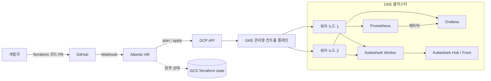

# Terraform으로 구축하는 GCP GKE 학습 환경

Terraform으로 서울 리전에 GKE Standard 클러스터와 워커 노드풀을 구성하고, GitHub PR 기반의 인프라 변경 흐름은 Atlantis로 관리하는 학습용 프로젝트입니다. 클러스터에는 Helm으로 Prometheus와 Grafana를 설치하고, Kubeshark로 Kubernetes 네트워크 트래픽을 관찰할 수 있습니다.

## 아키텍처



GKE 컨트롤 플레인은 Google이 관리하므로 별도의 마스터 VM을 만들거나 접속하지 않습니다. Terraform이 관리하는 VM은 워커 노드입니다.

## 기본 구성

| 항목 | 값 |
| --- | --- |
| 리전 / 존 | `asia-northeast3` / `asia-northeast3-a` (서울) |
| 클러스터 | GKE Standard, zonal, VPC-native |
| 워커 노드 | 2대, 기본 `e2-medium` |
| 네트워크 | 사용자 정의 VPC, Pod 및 Service용 보조 IP 범위 |
| Terraform 상태 | 사전에 만든 GCS 버킷의 원격 상태 |
| Atlantis | 별도 Compute Engine VM, GitHub App Webhook으로 PR 처리 |
| 모니터링 | Helm의 `kube-prometheus-stack` (Prometheus, Grafana 등) |
| 네트워크 관측 | 선택 사항: Kubeshark CLI 및 클러스터 구성요소 |

`e2-medium`은 공유 코어 머신 타입입니다. VM에는 2 vCPU가 노출되지만 기준 CPU는 1 vCPU이며, 메모리는 4GB입니다. GKE와 OS가 일부 자원을 사용하므로 Pod가 사용할 수 있는 양은 이보다 적습니다. 두 워커를 합쳐도 운영용 고가용성 구성이 아니며, 학습용으로 사용하세요.

### 네트워크 데이터플레인

클러스터의 Pod 네트워크는 GKE 기본 **Google CNI**와 `VPC_NATIVE`(Alias IP)를 사용합니다. Service의 ClusterIP 트래픽 처리는 각 노드의 `kube-proxy`가 담당하는 Legacy Dataplane입니다. CNI(Pod 네트워크 연결)와 Service 라우팅은 서로 다른 역할이며, 현재 Terraform 설정에는 Dataplane V2/Cilium이 활성화되어 있지 않습니다.

## 준비 사항

- 결제 계정이 연결된 GCP 프로젝트
- Terraform 1.5 이상, `gcloud`, `kubectl`
- Terraform을 실행할 로컬 계정의 GCP 권한
- Terraform 원격 상태용 GCS 버킷

GCS 버킷은 Terraform 초기화 전에 직접 만들어야 합니다. 버킷 이름은 전역에서 고유해야 하며, 상태 파일 복구를 위해 객체 버전 관리를 켜는 것을 권장합니다.

GCP CLI 로그인과 Terraform용 Application Default Credentials를 설정합니다.

```sh
gcloud auth login
gcloud config set project YOUR_PROJECT_ID
gcloud auth application-default login
```

프로젝트 서비스 API를 관리하기 전에 필요한 부트스트랩 API를 활성화합니다.

```sh
gcloud services enable cloudresourcemanager.googleapis.com serviceusage.googleapis.com --project=YOUR_PROJECT_ID
```

## GKE 배포

저장소 루트에서 아래 명령을 실행합니다. `YOUR_UNIQUE_STATE_BUCKET`에는 이미 만든 GCS 버킷 이름을 입력합니다.

```sh
terraform init \
  -backend-config="bucket=YOUR_UNIQUE_STATE_BUCKET" \
  -backend-config="prefix=gke/terraform/state"

cp terraform.tfvars.example terraform.tfvars
```

`terraform.tfvars`에 프로젝트 ID를 입력한 뒤 plan을 검토하고 적용합니다.

```hcl
project_id = "YOUR_PROJECT_ID"
```

```sh
terraform plan
terraform apply
```

적용이 끝나면 Terraform 출력의 `get_credentials_command`를 실행합니다.

```sh
gcloud container clusters get-credentials fastcampers-gke \
  --zone=asia-northeast3-a \
  --project=YOUR_PROJECT_ID

kubectl get nodes
```

`kubectl`에서 `gke-gcloud-auth-plugin`을 찾지 못한다는 오류가 나면 Google Cloud SDK의 GKE 인증 플러그인을 설치하고, `get-credentials` 명령을 다시 실행합니다.

## Atlantis를 통한 변경 관리

Atlantis는 GitHub Pull Request의 Terraform 변경사항을 plan하고, 승인된 변경을 apply하는 서버입니다. Atlantis 서버 자체의 Terraform 구성은 `atlantis/` 디렉터리에 있습니다. GCS 버킷과 Secret Manager의 GitHub App 키, Webhook secret, UI 비밀번호를 준비한 뒤 별도의 Terraform root로 배포합니다.

일반적인 흐름은 다음과 같습니다.

1. Terraform 코드를 브랜치에서 수정하고 PR을 생성합니다.
2. Atlantis가 PR에 plan 결과를 남깁니다.
3. plan과 변경사항을 검토합니다.
4. 권한이 있는 사용자가 PR에 `atlantis apply -p gke-seoul`을 댓글로 입력합니다.

공개 저장소에서는 포크 PR 실행을 허용하지 말고, `main` 브랜치 쓰기 권한과 Atlantis 실행 권한을 제한하세요. Atlantis는 GCP 리소스를 변경할 권한으로 Terraform 코드를 실행합니다. 자세한 설치 방법은 [Atlantis 설정 안내](atlantis/README.md)를 참고하세요.

## Prometheus와 Grafana 설치

Helm 저장소를 추가하고 차트를 설치합니다.

```sh
helm repo add prometheus-community https://prometheus-community.github.io/helm-charts
helm repo update

helm upgrade --install monitoring \
  prometheus-community/kube-prometheus-stack \
  --namespace monitoring \
  --create-namespace
```

Pod 상태를 확인합니다.

```sh
kubectl get pods -n monitoring
kubectl get events -n monitoring --sort-by=.lastTimestamp
```

Grafana는 로컬 포트포워드로 접속합니다. 명령을 실행한 터미널은 접속하는 동안 열어 둡니다.

```sh
kubectl port-forward -n monitoring svc/monitoring-grafana 3000:80
```

브라우저에서 `http://localhost:3000`을 열고 사용자 이름 `admin`으로 로그인합니다. 비밀번호는 Kubernetes Secret에서 필요할 때 확인하세요. 비밀번호를 README나 Git 저장소에 기록하지 마세요.

```sh
kubectl get secret -n monitoring monitoring-grafana \
  -o jsonpath='{.data.admin-password}' | base64 --decode
```

Helm 차트는 Kubernetes, CoreDNS, Prometheus, Node Exporter 등의 기본 Grafana 대시보드를 함께 설치합니다. Grafana 대시보드 ID 6417처럼 외부에서 가져온 대시보드는 현재 수집되는 메트릭 이름과 맞지 않아 일부 패널이 `N/A`일 수 있습니다. 먼저 기본 `Kubernetes / Compute Resources` 대시보드를 확인하세요.

## Kubeshark로 네트워크 트래픽 관찰 (선택 사항)

Kubeshark는 로컬 컴퓨터에 CLI를 설치한 다음, 현재 kubeconfig가 가리키는 GKE 클러스터에 구성요소를 배포해 트래픽을 관찰합니다. GKE 컨트롤 플레인에 접속해 설치하는 방식이 아닙니다. CLI 설치 방법은 [Kubeshark 공식 저장소](https://github.com/kubeshark/kubeshark)를 참고하세요.

아래 예시는 전용 네임스페이스에 설치하고, 전체 네임스페이스를 대상으로 캡처합니다.

```sh
kubectl create namespace kubeshark
kubeshark tap \
  -s kubeshark \
  --tls=false \
  --serviceMesh=false \
  --telemetry-enabled=false
```

CLI가 실행되는 동안 `http://127.0.0.1:8899`로 대시보드에 접속할 수 있습니다. `Ctrl+C`를 누르면 로컬 프록시가 종료되며, 클러스터 구성요소를 제거하려면 별도로 Helm release를 삭제해야 합니다.

현재 사용한 Kubeshark Community 플랜은 화면에 표시된 기준으로 최대 3개 노드 또는 60개 Pod까지 지원하며, Kubeshark 계정 로그인과 인터넷 연결이 필요합니다. 전체 트래픽 캡처는 노드 자원을 더 사용하고 민감한 요청 내용을 관찰할 수 있으므로, 실습 환경에서만 사용하고 사용량을 확인하세요.

## 리소스 부족과 트러블슈팅

모니터링 Pod가 `Pending`이면 아래를 확인합니다.

```sh
kubectl describe pod -n monitoring POD_NAME
kubectl describe nodes
kubectl top nodes
```

`Insufficient memory`는 노드의 allocatable 메모리 대비 Pod의 메모리 request 총합이 커서 스케줄링할 수 없다는 뜻입니다. 실제 메모리 압박이 없더라도 예약된 request가 가득 차면 Pod가 Pending일 수 있습니다. 이 프로젝트는 처음 `e2-micro`에서 모니터링 Pod들이 메모리 부족으로 대기했고, 워커 타입을 `e2-medium`으로 올려 해결했습니다.

Grafana가 재시작되면 `kubectl describe pod`의 Events에서 liveness/readiness probe 실패인지, `lastState.terminated.reason`이 `OOMKilled`인지 구분합니다. 컨테이너 수가 세 개인 Grafana Pod의 `2/3` 표시는 노드 수가 아니라 Pod 내부 컨테이너 준비 상태입니다.

## 삭제 및 비용 정리

모니터링과 Kubeshark를 설치했다면 각 Helm release를 제거합니다.

```sh
helm uninstall monitoring -n monitoring
helm uninstall kubeshark -n kubeshark
```

그 다음 저장소 루트에서 Terraform plan을 검토하고 인프라를 삭제합니다.

```sh
terraform destroy
```

Terraform destroy는 GCS 원격 상태 버킷과 Secret Manager 시크릿은 삭제하지 않습니다. 이들을 삭제할지 여부는 별도로 확인하세요. GCS 상태 버킷은 이후 Terraform 작업에 필요할 수 있으므로 상태 파일을 확인하지 않고 삭제하지 마세요.

## 포트폴리오 요약

GCP 서울 리전에 Terraform과 Atlantis를 이용해 GKE 인프라 변경을 PR 기반으로 관리했습니다. kube-prometheus-stack으로 Prometheus와 Grafana를 설치해 Kubernetes 메트릭을 시각화하고, 메모리 request/limit 및 스케줄러 이벤트를 이용해 Pod Pending과 Grafana probe 실패를 진단했습니다. Kubeshark를 추가해 클러스터 네트워크 트래픽 관찰까지 실습했습니다.
